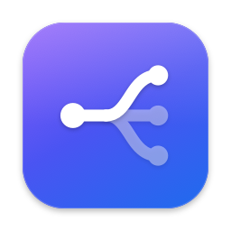

# Blink

From link to browser, instantly.

Blink is a small native macOS app that sits between your apps and your browsers. When you open a link from Mail, Slack, Notes or anywhere else, Blink either asks which browser to use or sends the link straight to the browser your rules pick.



## What it does

- Shows a compact picker next to the pointer with your browsers, their icons and the link's host. Press 1 to 9, use the arrow keys and Return, or click.
- Routes by domain. A rule like `example.com` (optionally with its subdomains) sends matching links to one browser without asking. Rules run top to bottom and the first match wins.
- Lets you create a rule from the picker with "Always open example.com in the chosen browser".
- Explains problems instead of guessing. If a rule's browser is gone or a browser refuses the link, Blink keeps the link and lets you retry, pick another browser, copy it or cancel. It never falls back silently.
- Queues links. Several links arriving at once open one after another, and the picker shows how many are waiting.
- Opens local HTML files that macOS hands to the default browser.
- Tells you when a browser is slow to take a link (for example while it starts up or shows a first-launch prompt), and lets you cancel instead of waiting forever.
- Keeps everything on your Mac. Settings live in one JSON file. Blink keeps no history, sends nothing over the network and never logs URLs.

Tested with Arc, Dia, Google Chrome, Zen, Safari and Brave, each both running and quit, on macOS 26. On macOS 14, Arc, Dia and Safari were tested from quit. Details are in [testing and release](docs/testing-and-release.md).

## Requirements

macOS 14 Sonoma or later, on Apple silicon or Intel.

## Install

There is no signed download yet. Build and install from source with a Swift 6 Xcode (developed with Xcode 27.1):

```sh
scripts/install-local.sh
```

The script runs the tests, builds a Release copy signed for this Mac only, installs it as `/Applications/Blink.app` and opens it. Signed, notarized builds for other Macs come from `scripts/release.sh` once a Developer ID is available (see [CONTRIBUTING](CONTRIBUTING.md)).

## First run

The welcome window walks through four steps:

1. Arrange your browsers. Apps that claim web links but don't open web pages (chat clients, terminals) start hidden.
2. Make Blink the default browser. macOS asks you to confirm. You can skip this and try Blink with Open Link… in the menu bar first.
3. Optionally open Blink at login. This is off unless you turn it on.
4. Open a test link.

Links that arrive while the welcome window is open wait and open when you finish.

## Everyday use

| In the picker | Does |
| --- | --- |
| 1 to 9 | Open in that browser (works on any keyboard layout, with or without Shift) |
| Up, Down, Return | Move the selection, open in the selected browser |
| Escape or ⌘W | Cancel this link; the next waiting link appears |
| ⌘C or Copy Link | Copy the full link and keep it waiting |
| Full link | Show the complete URL. The preview hides query strings, which often hold tokens |

The menu bar icon has Open Link…, Settings… and Quit. Opening Blink from Finder or Spotlight shows Settings.

Settings has three tabs:

- **General.** Default browser status (it tells you when only HTTP or only HTTPS points at Blink), login item, Open Link…, the welcome window, and Reset Settings.
- **Browsers.** Picker order, visibility and refresh. Hidden browsers stay usable by rules. Browsers you've uninstalled keep their place until you forget them.
- **Rules.** Add, edit, enable, disable, reorder and delete rules. Blink warns when an earlier rule makes a later one unreachable or when a rule's browser isn't installed. The "Test a link" field tells you what Blink would do with any URL without opening it.

## Stop using Blink

1. In System Settings › Desktop & Dock, set "Default web browser" back to your browser.
2. Turn off Open Blink at login in Blink's settings, or remove it in System Settings › General › Login Items.
3. Quit Blink and move `/Applications/Blink.app` to the Trash.
4. To remove its settings too, delete `~/Library/Application Support/dev.melmayan.blink`.

## Privacy

Blink stores browser order, visibility, your rules and whether you finished the welcome window. Links exist only in memory until they open or you cancel them; quitting discards them after asking. Logs record operations, timings and error codes, never URLs or hosts. Blink makes no network requests.

## Limitations

- Links opened inside a browser stay in that browser. Some apps open links in their own web views or always use a specific browser; those links never reach Blink.
- Blink chooses a browser, not a profile, space or container. The browser's own default profile opens the link.
- A link counts as opened when macOS accepts it for the browser. Blink can't know whether the page then loads.
- Rules match whole hosts only: no paths, wildcards or regular expressions.

## Documentation

[Project context](CONTEXT.md) summarizes decisions. The [product requirements](docs/product.md), [interaction design](docs/interaction-design.md) and [architecture](docs/architecture.md) describe the behavior in detail. [Testing and release](docs/testing-and-release.md) records what has been verified. [Decisions](docs/decisions.md) lists what is settled and what is still open. [CONTRIBUTING](CONTRIBUTING.md) covers building and testing.

Blink is proprietary. Copyright © 2026 Marek Elmayan, all rights reserved. The repository has no license file, so it grants no rights to use, copy or redistribute the code.
