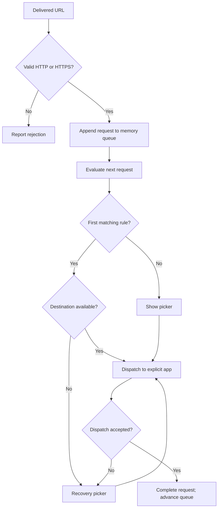

# Architecture

Status: proposed; platform assumptions must pass [milestone 0](build-plan.md). See [ADR 0001](adr/0001-native-local-app.md).

## App structure

Use one Swift macOS application with SwiftUI for views and AppKit for lifecycle, menu bar, window focus, and URL dispatch. Start with a macOS 14 deployment target and universal architecture support. Pin the actual Xcode/Swift versions once the project exists.

Keep a small set of concrete responsibilities, not a service framework:

| Component | Responsibility |
| --- | --- |
| App delegate / URL intake | Receive OS open events and enqueue validated requests |
| Request coordinator | Own queue, routing outcomes, picker state, and dispatch lifecycle |
| Browser catalog | Discover eligible apps and resolve bundle IDs to current application URLs |
| Rule evaluator | Pure first-match domain evaluation |
| Browser opener | Explicit application dispatch and completion/error mapping |
| Configuration store | Validate, migrate, read, and atomically write preferences |
| Views | Onboarding, picker, settings, and recovery controls |

Use dependency injection only at OS and persistence boundaries needed by tests. No backend, local HTTP server, database, agent, or helper process is planned.

## macOS integration

Register HTTP/HTTPS handling through app bundle metadata and verify eligibility as a default browser in a built app. Use `NSApplicationDelegate.application(_:open:)` as the primary intake path. Verify cold-launch delivery and avoid registering a second event path that duplicates intake.

Use `NSWorkspace` discovery APIs for web handlers and explicit-application opening. Exclude Blink by bundle identity and resolved app location. A missing or ineligible destination produces recovery UI; never call generic default-handler opening to recover because Blink may be that default.

Default-browser changes are explicit user actions. Use the supported `NSWorkspace` scheme-handler API when available, with availability checks; observe both HTTP and HTTPS afterward. Use `SMAppService.mainApp` for opt-in login launch and read the system's status rather than trusting a saved Boolean. Do not overwrite user changes to defaults on later launches.

The initial distribution proposal is Developer ID signing plus notarization, with Hardened Runtime. App Sandbox policy remains a milestone-0 decision; do not invent entitlements before proving which operations require them. No Accessibility, screen-recording, or browser automation permissions should be needed for the MVP.

## Request lifecycle



Each request has `id`, `originalURL`, `normalizedHost`, and state: queued, choosing, dispatching, failed, completed, or cancelled. Cancellation also advances the queue. Serialize transitions on the main actor. Snapshot routing configuration when a request becomes active; later settings edits apply to subsequent requests. Recheck destination availability at dispatch.

Only choosing or failed requests can start a dispatch. Ignore stale completion callbacks by request ID and dispatch-attempt ID. Do not deduplicate URLs: two intentional clicks may have identical values. Automatic recursive recovery is prohibited; an error needs a user action before retry.

## URL and rule semantics

Accept absolute `http` and `https` URLs with a nonempty valid host, no control characters, and no embedded username/password. Ports are allowed in incoming URLs; rules are host-only and ignore ports. Unsupported schemes, relative paths, and malformed values are rejected. Never run incoming values through a shell, fetch their content, or resolve redirects.

Preserve the accepted URL for dispatch. Derive a separate comparison host by lowercasing, removing a single trailing DNS dot, and normalizing internationalized domains to ASCII through one shared, tested normalization function. Use that same function when saving rule domains. Do not decode the entire URL before parsing. Verify Foundation's normalization behavior in milestone 0; reject unsupported representations rather than inventing inconsistent matching.

For exact rule domain `d` and normalized host `h`, match only `h == d`. For an include-subdomains rule, match `h == d` or `h.hasSuffix("." + d)`. Thus `docs.example.com` matches `example.com`, while `notexample.com` and `example.com.evil.test` do not. Never use a bare string suffix. IP literals and single-label hosts can have exact rules; disable subdomain matching for them. MVP does not infer registrable domains or public suffixes; rules use precisely the host entered by the user.

Evaluate enabled rules in stored array order. Return either `noMatch` or `matched(ruleID, destinationBundleID)`. Destination availability is a separate check: do not skip an unavailable matched destination and accidentally send a work link elsewhere. See [ADR 0002](adr/0002-explicit-routing.md).

## Persistent data

Store one UTF-8 JSON file under `Application Support/<bundle-id>/configuration.json`. Select the permanent bundle ID before shipping. Use Foundation's appropriate application-support location for the chosen sandbox policy.

Proposed schema version 1:

```json
{
  "schemaVersion": 1,
  "onboardingCompleted": false,
  "browsers": [
    { "bundleID": "com.apple.Safari", "isVisible": true }
  ],
  "rules": [
    {
      "id": "7D3AD686-228B-4A39-B316-E55D476C78E2",
      "domain": "example.com",
      "includeSubdomains": false,
      "destinationBundleID": "com.apple.Safari",
      "isEnabled": true
    }
  ]
}
```

Browser array order is picker order; rule array order is precedence. Discover new browsers as visible entries appended in localized name order. Preserve unavailable entries so reinstalling does not erase preferences. Browser names, icons, and install paths are runtime catalog data, not durable identity. Duplicate installations with the same bundle ID resolve through the system's current application resolution; choosing among separate installs is outside MVP.

Validate schema, types, unique browser IDs and rule IDs, and canonical rule domains. Missing file means first run. Invalid or unknown-newer schema means read-only recovery using temporary defaults; do not partially load rules or overwrite the original. Serialize writes, write to a temporary file in the same directory, then replace atomically. Commit UI changes only after successful persistence. Future migrations must preserve a backup and have fixtures; v1 needs no speculative migration framework.

## Privacy and diagnostics

Only preferences and explicit user-created domain rules persist. Domain rules may themselves be sensitive; do not include configuration in diagnostic exports by default. No request history, page titles, URL analytics, clipboard monitoring, or network inspection.

Logs may contain operation category, sanitized error code, and timing. Exclude URL, host, query, fragment, credentials, and arbitrary OS error descriptions that may embed them. Copy Link is a user-triggered disclosure of the full URL to the clipboard. Clear completed/cancelled request references promptly.

## Platform references

Checked 2026-10-17. API availability and behavior still require SDK compilation and device verification.

- [NSApplicationDelegate](https://developer.apple.com/documentation/appkit/nsapplicationdelegate): app lifecycle and URL delivery.
- [NSWorkspace](https://developer.apple.com/documentation/appkit/nsworkspace): handler discovery and explicit application dispatch.
- [SMAppService.mainApp](https://developer.apple.com/documentation/servicemanagement/smappservice/mainapp): login service integration.
- [Preparing an app for distribution](https://developer.apple.com/documentation/xcode/preparing-your-app-for-distribution): distribution capabilities and signing.
- [Notarizing macOS software](https://developer.apple.com/documentation/security/notarizing-macos-software-before-distribution): direct-distribution validation.
