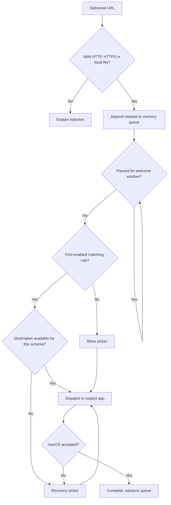

# Architecture

Status: implemented. Platform evidence is in the [integration report](integration-report.md). See [ADR 0001](adr/0001-native-local-app.md) and [ADR 0002](adr/0002-explicit-routing.md).

## App structure

One Swift macOS application, an agent app (`LSUIElement`) with a menu bar item. The picker is a borderless, non-activating `NSPanel`, so it can take keyboard input even when cooperative activation keeps another app in front. AppKit owns the lifecycle, windows, focus and URL dispatch. SwiftUI draws the picker, settings and welcome content. Logic that doesn't need AppKit lives in the local `BlinkCore` package so it can be tested without launching the app.

| Component | Where | Responsibility |
| --- | --- | --- |
| URL intake | `AppDelegate`, `AppModel.handleDelivered` | Receive open events, validate, enqueue or explain the rejection |
| Link validation | `BlinkCore/ValidatedLink.swift` | Accept HTTP/HTTPS (and delivered local files), derive the comparison host |
| Host normalization | `BlinkCore/HostNormalizer.swift` | One function for incoming hosts and rule domains |
| Rule evaluator | `BlinkCore/Rules.swift` | Pure first-match evaluation and shadowing detection |
| Request coordinator | `BlinkCore/RequestCoordinator.swift` | Queue, routing outcome, picker need, dispatch lifecycle |
| Configuration store | `BlinkCore/ConfigurationStore.swift`, `Preferences` | Validate, read and atomically write; commit UI changes after saving |
| Browser catalog | `BrowserCatalog` | Discover web handlers, exclude Blink, resolve bundle IDs, icons |
| Profiles | `BlinkCore/BrowserProfiles.swift`, `ProfileCatalog` | Where each browser lists its profiles, parsing those lists, reading them off the main thread |
| Picker rows | `BlinkCore/PickerOutline.swift` | Browser and profile rows, expansion, selection and number keys |
| Browser opener | `WorkspaceOpener`, `ProfileScript`, `ActivationHandoff` | Explicit application and profile dispatch, activation handoff |
| System integration | `SystemIntegration` | Default handler status and change, login item |
| Views | `Picker/`, `Settings/`, `Onboarding/`, `OpenLinkWindowController` | Picker, settings, welcome, Open Link, recovery |

Dependency injection exists only where tests need it: the coordinator takes a `BrowserLocating`, a `LinkOpening` and a rules closure. There is no backend, local server, database or third-party dependency. The only helper process is `/usr/bin/osascript`, started to open a link in an Arc space or Dia profile.

## macOS integration

`Info.plist` declares the `http` and `https` URL schemes (role Viewer) and `public.html`/`public.xhtml` documents at rank Alternate, which makes Blink eligible as the default web browser. `NSApplicationDelegate.application(_:open:)` is the only intake path. The model exists from `applicationWillFinishLaunching` because cold-launch links arrive before `applicationDidFinishLaunching`.

Discovery uses `NSWorkspace.urlsForApplications(toOpen:)` for both schemes and for the HTML content type. Blink excludes itself by bundle ID and by resolved location. Duplicate installs resolve through `urlForApplication(withBundleIdentifier:)`. An app that handles web links but not HTML starts hidden in the picker; see [interaction design](interaction-design.md).

Dispatch uses `NSWorkspace.open(_:withApplicationAt:configuration:)`. `activates` is true only when no other link is waiting, so Blink keeps focus for the next picker. Before dispatching, Blink calls `NSApp.yieldActivation(toApplicationWithBundleIdentifier:)`; afterwards it activates the returned application. If Blink itself becomes active with no window within two seconds of a dispatch, it hands activation back. Without this, macOS 14's cooperative activation left Blink in front of the browser. Blink never calls a generic default-handler open to recover from a failure.

Default-browser changes happen only on a click. `NSWorkspace.setDefaultApplication(at:toOpenURLsWithScheme:)` runs for HTTP, then for HTTPS if it isn't already Blink, and Blink reads both handlers back afterwards. Status is refreshed whenever Blink becomes active or Settings becomes key, so changes made in System Settings show up. Launch at login uses `SMAppService.mainApp`, and Blink displays the service's status, including "requires approval".

Profile dispatch depends on the browser family ([ADR 0003](adr/0003-profile-destinations.md), [capability matrix](profiles-capability.md)). Chromium and Firefox browsers get `--profile-directory=<dir>` or `-P <name>` through `NSWorkspace.openApplication` with `createsNewApplicationInstance`; the new process hands the link to the running browser and exits, or starts the browser. Arc and Dia get a fixed AppleScript run by `osascript`, with the space ID or profile name and the URL as arguments. The script waits for a window, asks a browser without one to reopen, and in Arc looks for the window that holds the space, since Little Arc windows don't. Before any profile dispatch, Blink re-reads the browser's profile list and fails the request if the profile is gone.

Distribution is Developer ID with the hardened runtime and one entitlement, `com.apple.security.automation.apple-events`, with `NSAppleEventsUsageDescription` in `Info.plist`, for Arc and Dia. The app is not sandboxed. See the integration report for why.

## Request lifecycle



The active request has a phase: choosing, dispatching or failed. Queued, completed and cancelled requests are represented by their place in or absence from the queue. All transitions run on the main actor. Rules are read when a request becomes active, so later edits apply to later requests. Availability is checked again at every dispatch.

Only choosing or failed requests can start a dispatch, which prevents double submission. If macOS hasn't answered a dispatch after 10 seconds, the request is marked slow: the picker appears and Cancel becomes available. Cancelling then ends the request, and the late answer is ignored like any stale callback. Each dispatch has an attempt ID, and completions for an older attempt or another request are ignored. Cancel is ignored while a dispatch is in flight, until it becomes slow. Identical URLs stay separate requests. Failures never retry or fall back automatically. UI actions carry the request ID they were shown for, so a late click can't act on the next request.

## URL and rule semantics

Blink accepts absolute `http` and `https` URLs with a nonempty, valid host, no raw control characters and no user name or password. Ports are allowed in links; rules ignore them. Local `file` URLs are accepted only when macOS delivers them, which happens for HTML documents while Blink is the default browser. They show the picker and never match rules. Typed links must be web links.

The accepted URL is dispatched unchanged. The comparison host comes from `URLComponents.encodedHost`: Foundation converts Unicode to punycode, then Blink lowercases it and removes one trailing dot. Hosts with percent escapes, empty labels or characters outside `a-z 0-9 - _` are rejected. Rule input goes through the same function after rejecting schemes, ports, paths, wildcards, credentials and inner whitespace.

For rule domain `d` and host `h`: an exact rule matches only `h == d`. A rule that includes subdomains also matches when `h` ends with `"." + d`. `docs.example.com` matches `example.com` with subdomains; `notexample.com` and `example.com.evil.test` don't. IP literals and single-label hosts match exactly only. Any host whose last label is all digits counts as an IP address, so a rule for `0.0.1` can never match `10.0.0.1` as a subdomain.

Enabled rules are evaluated in list order. The result is `noMatch` or `matched(ruleID, destination)`, where a destination is a bundle ID and an optional profile. An unavailable destination opens the recovery picker and never falls through to a later rule. A rule is shadowed when an earlier enabled rule matches every host it would match; the Rules tab and the rule editor both say so.

## Persistent data

One UTF-8 JSON file at `~/Library/Application Support/dev.melmayan.blink/configuration.json`. The folder name is the bundle ID, so it must not change between releases.

Schema version 2. Version 1 files, which stored a rule's browser as `destinationBundleID`, load as version 2 and are rewritten on the next save ([ADR 0003](adr/0003-profile-destinations.md)). `showsMenuBarIcon` may be missing from files written by early builds; they load with the icon shown. `hiddenProfileIDs` may be missing; it defaults to empty.

```json
{
  "schemaVersion": 2,
  "onboardingCompleted": false,
  "showsMenuBarIcon": true,
  "browsers": [
    { "bundleID": "com.google.Chrome", "isVisible": true, "hiddenProfileIDs": ["Profile 3"] }
  ],
  "rules": [
    {
      "id": "7D3AD686-228B-4A39-B316-E55D476C78E2",
      "domain": "example.com",
      "includeSubdomains": false,
      "destination": {
        "bundleID": "com.google.Chrome",
        "profile": { "id": "Profile 1", "name": "Work" }
      },
      "isEnabled": true
    }
  ]
}
```

A profile's `id` is what survives renames: an Arc space ID, a Chromium profile directory or a Firefox profile path. `name` is the last name seen, shown when the profile is gone. A destination without `profile` opens the browser normally.

Browser order is picker order and rule order is precedence. Newly discovered browsers are appended in localized name order. Entries for uninstalled browsers stay, so reinstalling keeps their place, until the user forgets them in Settings.

Loading checks the schema version first. A newer version, invalid JSON, a wrong structure, duplicate browser or rule IDs, empty identifiers, or a non-canonical rule domain puts the store in read-only recovery. Blink then runs with temporary defaults (discovered browsers, no rules), saves nothing, and Settings explains the problem. Reset moves the original to `configuration.backup-<timestamp>.json` and writes fresh defaults. A missing file means first run.

Writes validate first, write a temporary file in the same directory, `fsync` it and `rename` it over the original. User edits appear only after the write succeeds; a failed save shows an alert with Try Again and leaves the previous settings in effect. Newly discovered browsers are not a user edit, so a failed save keeps them in memory and logs the failure.

## Privacy and diagnostics

Only preferences and user-created rules persist. Links stay in memory and are dropped when they open, are cancelled or are discarded at quit. Blink makes no network requests and doesn't read the clipboard.

To list profiles, Blink reads `Local State` (Chromium and Dia), `StorableSidebar.json` (Arc) and `profiles.ini` (Firefox and Zen) under `~/Library/Application Support`, plus whether each Firefox profile has a `prefs.js`. It keeps profile IDs and names in memory and never reads history, cookies, tabs or other files.

Logs use `os.Logger` with the categories intake, dispatch, configuration, profiles and system. They record operations, timings, rejection reasons, error domains with codes and AppleScript error numbers. They never contain URLs, hosts, rule domains, profile names or localized error descriptions, which can embed URLs. Copy Link is the only way a URL leaves Blink, and the user triggers it.

## Platform references

- [NSApplicationDelegate](https://developer.apple.com/documentation/appkit/nsapplicationdelegate)
- [NSWorkspace](https://developer.apple.com/documentation/appkit/nsworkspace)
- [NSApplication.yieldActivation](https://developer.apple.com/documentation/appkit/nsapplication/yieldactivation(toapplicationwithbundleidentifier:))
- [SMAppService.mainApp](https://developer.apple.com/documentation/servicemanagement/smappservice/mainapp)
- [Notarizing macOS software](https://developer.apple.com/documentation/security/notarizing-macos-software-before-distribution)
